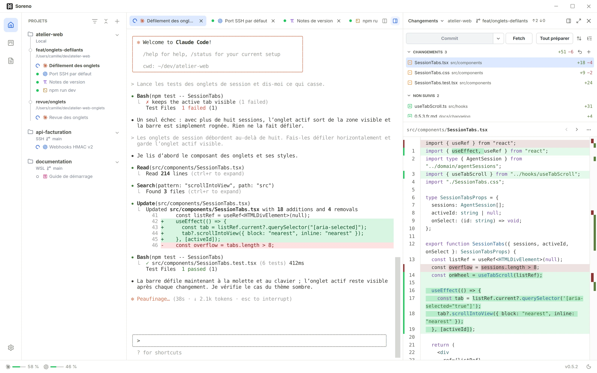

# Soreno

Soreno is a desktop app for Windows and macOS. It combines local note-taking with a workspace for command-line coding agents (Pi, OMP, Codex, Claude Code).

> **Early preview.** Soreno is under active development and the source code is not public. This repository only hosts installers and update files.

## Download

Get the latest version from the [Releases page](https://github.com/TellyD/Soreno-Releases/releases/latest).

| Platform | File |
| --- | --- |
| Windows (64-bit) | `Soreno_<version>_x64-setup.exe` |
| macOS – Apple Silicon | `Soreno_<version>_aarch64.dmg` |
| macOS – Intel | `Soreno_<version>_x64.dmg` |

Ignore the `.sig`, `.tar.gz` and `latest.json` files. The app's auto-updater uses them.

### Windows

The installer is not code-signed yet, so Windows SmartScreen may say the publisher is unknown. Click **More info → Run anyway** to install.

### macOS

The macOS builds are signed with an Apple Developer ID and notarized. Open the DMG and drag Soreno into Applications.

## Updates

Once installed, Soreno checks for a new version at launch and offers it in the status bar. Your notes are kept, and the app won't restart while an agent session is still running.

## Your data

Notes stay on your computer, in local SQLite vaults:

- Windows: `%APPDATA%\com.soreno.notes`
- macOS: `~/Library/Application Support/com.soreno.notes`

## Feedback

Bug reports and suggestions are welcome in [Issues](https://github.com/TellyD/Soreno-Releases/issues).

## License

Soreno is proprietary software and no license is granted for now. You may download and use the published builds. Redistribution, modification and reverse engineering are not allowed. Copyright © 2026 Soreno. All rights reserved.

---

### En bref (FR)

Soreno est une application de notes locale et un espace de travail pour agents CLI, sur Windows et macOS. C'est une préversion : le code source n'est pas public pour l'instant. Téléchargez l'installateur dans [Releases](https://github.com/TellyD/Soreno-Releases/releases/latest). Sous Windows, si SmartScreen bloque l'installation, cliquez sur **Informations complémentaires → Exécuter quand même**.
